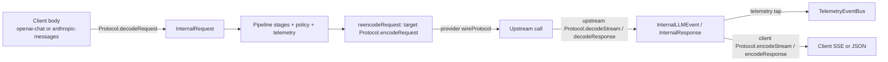

# aitoolgate — architecture

Hexagonal, single-process TypeScript app. `src/ports/` defines contracts. Adapters implement them. `src/server/index.ts` is the composition root.

## Module map (evidence: committed `src/` tree)

| Path | Responsibility | Key files |
| --- | --- | --- |
| `src/server/index.ts` | HTTP server, mounts API/WS/dashboard, wires stores and telemetry, loads config | `createServer` |
| `src/composition.ts` | Default builders behind the `ProxyDefaults` port | `defaultProxyDefaults` |
| `src/proxy/` | Route handlers, protocol translation, upstream forwarding, SSE | `index.ts`, `openai.ts`, `anthropic.ts`, `context.ts`, `upstream.ts`, `translate.ts` |
| `src/protocols/` | Wire-protocol codecs (`openai-chat`, `anthropic-messages`) and registry | `registry.ts`, `request-extra.ts` |
| `src/providers/` | Upstream provider adapters (`generic`, `copilot`) and device OAuth | `registry.ts`, `generic/adapter.ts`, `copilot/adapter.ts` |
| `src/policy/` | Rule engine, matchers, actions, per-session feedback | `ruleEngine.ts`, `policyStage.ts`, `matchers/`, `actions/`, `feedbackStore.ts` |
| `src/telemetry/` | Event bus, collector, tool metrics, SSE extraction, token estimates, tool-result storage | `event-bus.ts`, `collector.ts`, `toolMetrics.ts`, `stream-extract.ts`, `tokenEstimate.ts`, `toolResultStore.ts`, `sqliteToolResultPersister.ts` |
| `src/api/` | REST routes, WebSocket server, rule and provider stores and validation | `http.ts`, `ws.ts`, `ruleStore.ts`, `persistentRuleStore.ts`, `providerStore.ts`, `persistentProviderStore.ts`, `crudStore.ts`, `providerProbe.ts`, `deviceFlowRegistry.ts` |
| `src/pipeline/` | Default ordered-stage pipeline (request, response, result phases) | `index.ts` (`createPipeline`, `DefaultPipeline`) |
| `src/session/` | Session-key derivation (hash of stable message prefix) | `session.ts` |
| `src/storage/` | `node:sqlite` storage and schema migrations | `sqlite.ts`, `schema.ts` |
| `src/ports/` | Framework-independent contracts | `domain.ts`, `pipeline.ts`, `provider.ts`, `protocol.ts`, `telemetry.ts`, `llm.ts`, `auth.ts`, `strategy.ts` |
| `config/config.ts` | Env-based config (`PORT`, `RULES_*`, `TOOL_RESULTS_*`, `TOOL_ERROR_PATTERNS`, `COPILOT_DEVICE_CLIENT_ID`) | `loadConfig` |
| `dashboard/` | Static HTML, CSS, and vanilla JS served by the server | `index.html`, `app.js`, `js/` |

## Core contracts (evidence: `src/ports/llm.ts`, `src/ports/protocol.ts`, `src/ports/provider.ts`)

Two distinct vocabularies. Do not conflate them.

- **Wire protocol (codec side).** `Protocol` (`src/ports/protocol.ts`) has `id` values `openai-chat` and `anthropic-messages`. It decodes and encodes request bodies, non-stream responses, and SSE streams. `CODECS` in `src/proxy/translate.ts` maps each id to its codec.
- **Provider type (upstream side).** `ProviderAdapter` (`src/ports/provider.ts`) has `wireProtocol: 'openai' | 'anthropic'` (`WIRE_PROTOCOLS`). The short names are not the same as the `Protocol.id` values. `resolveEndpoint(config)` returns `{ baseUrl, protocol }`.
- **Provider adapter ids** are registry keys in `PROVIDER_ADAPTERS` (`src/providers/registry.ts`): `generic-openai` (`createGenericAdapter('openai')`), `generic-anthropic` (`createGenericAdapter('anthropic')`), and `copilot` (`createCopilotAdapter()`, wire `openai`). Copilot is a provider that speaks the OpenAI wire protocol. It is not a separate protocol. `DEFAULT_PROVIDER_ADAPTER_ID` and `wireProtocolFor` (defaults to `openai` for unknown ids) live in the same file.

**Internal request (`InternalRequest`).** Protocol-neutral. Required fields: `model`, `messages: Message[]`. Optional fields: `maxTokens`, `temperature`, `topP`, `tools: ToolDefinition[]`, `toolChoice` (opaque, carried verbatim), `stream`, `streamOptions` (`include_usage` is forced on stream encode), and `extra: RequestExtra`. `extra` holds unmodeled fields and is re-merged only when the target protocol equals `extra.protocol` (same-protocol only).

**Message model.** `Message` has `role: MessageRole`, `parts: MessagePart[]`, and optional `plainStringContent` (origin marker only). `MessagePart` variants: `TextPart`, `ReasoningPart`, `ToolCallPart`, `ToolResultPart`, and `OpaquePart`. `ToolDefinition` describes tools. `Usage` carries token counts.

**Internal response (`InternalResponse`).** Used by `decodeResponse` and `encodeResponse` for non-stream bodies. `FinishReason` is `stop | length | tool-calls | content-filter | other`.

**Internal stream event (`InternalLLMEvent`).** This is the emitted union, a discriminated union on `type`:
- `text` (`text`)
- `reasoning` (`text`, optional `signature`, `redactedData`)
- `tool-call` (`id`, `name`, `args`, optional `rawArgs` exact wire string, optional `index`)
- `tool-result` (`id`, `name`, `content`, `isError`)
- `usage` (`usage`)
- `step-start` (optional `id`, `model`)
- `step-finish` (`finishReason`)
- `finish` (`finishReason`)

**Protocol operations** (all on `Protocol`): `encodeRequest`, `decodeRequest` (returns `undefined` when not a recognisable request), `decodeResponse`, `encodeResponse`, `decodeStream` (SSE text chunks → events, unknown frames skipped), `encodeStream` (events → complete SSE frames), `applyToolCalls` (rewrites tool calls in a raw response body).

## Request and response flow

Verified call path (evidence: `src/proxy/translate.ts`, `src/proxy/upstream.ts`, `src/pipeline/index.ts`, `src/providers/registry.ts`):

1. The client sends a request to `/v1/chat/completions` or `/v1/messages`. The handler reads the body (`readJSONBody`) and builds a `RequestContext`.
2. Client-protocol decoding happens in `Protocol.decodeRequest`. An undecodable body returns `400` before anything goes upstream (`reencodeRequest` returns `undefined`).
3. The pipeline (`createPipeline` → `DefaultPipeline`) runs `onRequest` for each stage. The policy stage evaluates rules and applies actions to the request.
4. The active provider is read at request time (hot switch). `lookupProviderAdapter` resolves the adapter. Its `resolveEndpoint` yields the upstream `baseUrl` and wire protocol. `reencodeRequest(clientId, upstreamId, request, model)` decodes then encodes through `CODECS`. Same-protocol calls keep `extra`.
5. The upstream client forwards the wire body. `forwardRequest` handles non-stream responses. `streamForClient` handles streams.
6. Streaming (`src/proxy/upstream.ts`): upstream SSE → `from.decodeStream` → `teeEvents` tap (telemetry) → `to.encodeStream` → client. Client-side encoding happens per event here. README "Streaming and reasoning" and `src/proxy/context.ts` `streamSameProtocolRequest` describe the same-protocol case. This memory did not re-verify that the same-protocol case has no bypass.
7. Non-stream responses: `convertResponse(upstreamId, clientId, response)` decodes with the upstream codec (falls back to `EMPTY_RESPONSE`) and encodes with the client codec.
8. Non-SSE 2xx JSON responses become a synthetic SSE stream when they have content. Metadata-only JSON returns `502`. Undecodable JSON passes through raw (README).
9. Tool-call events and policy interventions go to the shared `TelemetryEventBus`. Consumers are the collector, the WS broadcast, and optional SQLite storage. Failing subscribers are isolated, so telemetry does not break proxying (`policyStage.ts` `emitTelemetry`, `event-bus.ts`).

## Provider inventory (evidence: `PROVIDER_ADAPTERS`, `src/providers/*/adapter.ts`)

| Adapter id | Factory | Wire protocol | Notes |
| --- | --- | --- | --- |
| `generic-openai` | `createGenericAdapter('openai')` | `openai` | Generic OpenAI-compatible upstream |
| `generic-anthropic` | `createGenericAdapter('anthropic')` | `anthropic` | Generic Anthropic-compatible upstream |
| `copilot` | `createCopilotAdapter()` | `openai` | Device OAuth auth; adds Copilot headers in `decorateHeaders`; `listModels` requires a token |

Adapters differ only by `wireProtocol`, `auth`, `resolveEndpoint`, optional `decorateHeaders`, and optional `listModels`. Adding a provider type requires its module plus one `PROVIDER_ADAPTERS` entry (see Design decisions).

## Design decisions (verified in code/README)

- **Zero runtime deps:** only `node:` built-ins. The WebSocket server is hand-written in `src/api/ws.ts`. Do not add runtime packages without approval.
- **Single active upstream:** one active provider at a time. Concurrent multi-provider routing is out of scope (README "Security and limitations").
- **Two SQLite databases:** rules/events/providers (`RULES_DB_PATH`, default `data/rules.db`) are separate from raw tool results (`TOOL_RESULTS_DB`). Raw tool-result persistence is off by default (`TOOL_RESULTS_ENABLED=false`).
- **Adapter registry:** provider types are keyed in `src/providers/registry.ts` `PROVIDER_ADAPTERS`. A new type needs its module plus one entry there.
- **Extension points:** new wire protocol = a `Protocol` implementation registered in `CODECS` (`src/proxy/translate.ts`) and `src/protocols/registry.ts`. New provider type = a `ProviderAdapter` plus a `PROVIDER_ADAPTERS` entry. Both are verified by the symbols above, but the full registration path for a new protocol was not traced.
- **Config default location:** DB defaults under `~/.aitoolgate` (`config/config.ts`), not the cwd. The README documents `data/` paths, so the two disagree. Verify before relying on either.
- **Management endpoints are not authenticated.** Provider detail responses can include raw API keys (README security section).

## Dashboard UI (summary)

Static vanilla-JS dashboard in `dashboard/`, served by `src/server/index.ts`. It consumes the `api/...` REST routes and `/ws` WebSocket described above. Details, data flows, tests, and a verified missing-import caveat are in [ui/dashboard.md](ui/dashboard.md).

## Open items seen in committed docs

- README: Anthropic unsigned thinking is dropped on the wire. This is marked as an open decision, not settled behavior.
- `src/policy/policyStage.ts`: session-key tracking uses the last request's key. The README and code comment both say this is adequate only for sequential single-client use.
